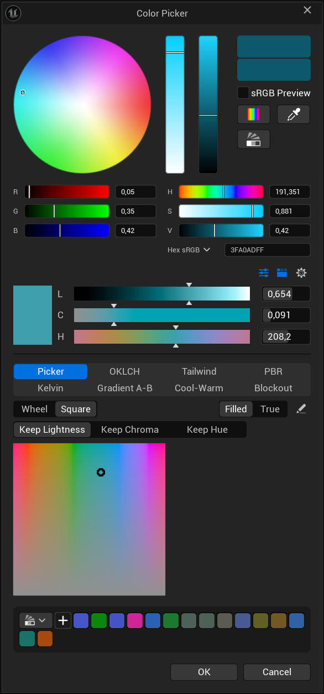
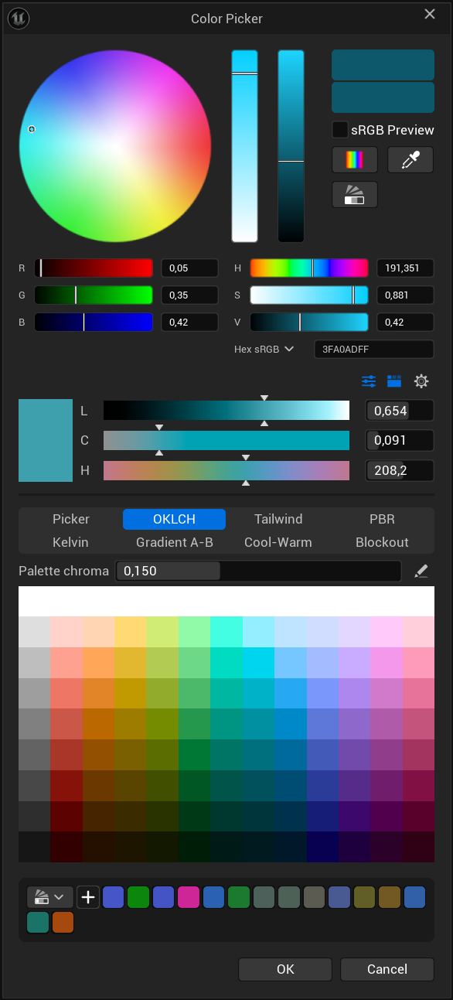
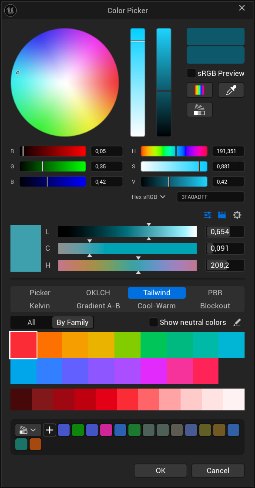
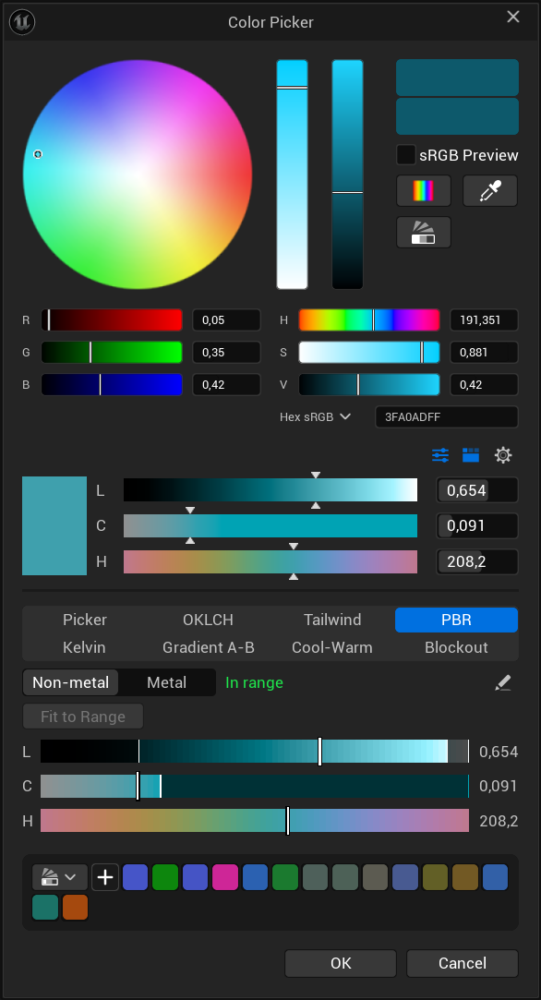
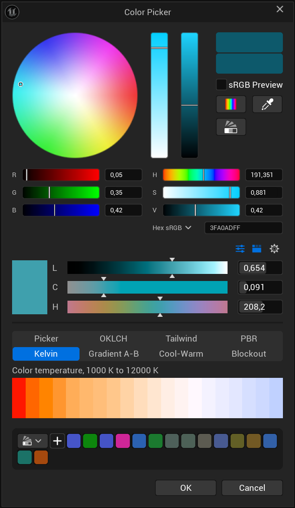
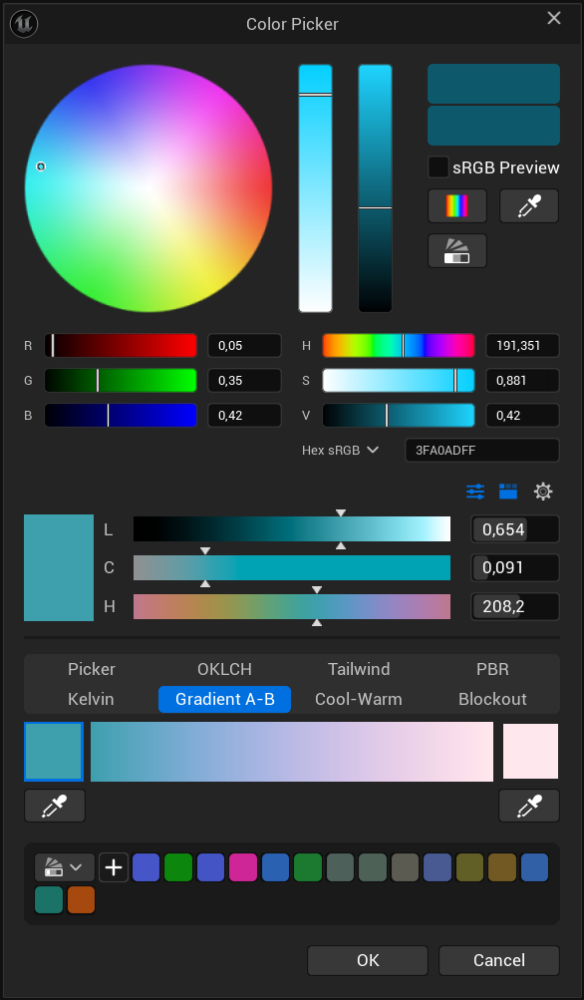
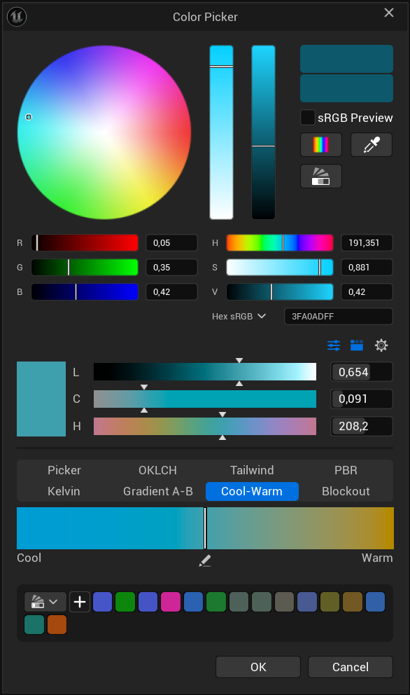
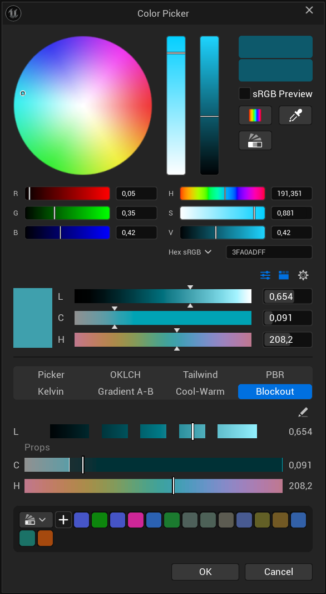

# Extra Color Tools

Documentation for the Extra Color Tools plugin for Unreal Engine. The plugin itself is distributed through Fab; this repository holds its manual and is the place to report problems.

Perceptual color picking for the Unreal Editor. The plugin adds OKLCH controls wherever a color is picked: inside the
standard Color Picker, behind an **LCH** button next to every color property, and in a dockable tab.

OKLCH describes a color by lightness (L), chroma (C) and hue (H) the way the eye reads them: two colors with the same
L look equally light whatever their hue, which RGB and HSV do not give you.

- Engine: Unreal Engine 5.8
- Platform: Windows (editor only; nothing is added to packaged games)
- Languages: English, Russian



*The plugin's block inside the standard Color Picker window, under the stock sliders.*

## Installing

1. Copy the `ExtraColorTools` folder into the `Plugins` folder of your project (create the folder if there is none),
   or install the plugin to the engine from Fab.
2. Start the editor and enable **Extra Color Tools** under **Edit > Plugins** if it is not enabled yet.
3. Restart the editor when asked.

## Where it shows up

| Place | What you get |
|---|---|
| Color Picker window | The plugin's block under the stock RGB / HSV sliders |
| **LCH** button next to a color property | The same block in a popup; a picked color is written to the property, with undo |
| **Tools > Extra Color Tools** | A dockable tab that follows its size; a picked color is copied to the clipboard and can be pasted onto any color property |

Both integrations can be switched off in **Edit > Editor Preferences > Plugins > Extra Color Tools**.

## The block

From top to bottom:

1. **Buttons** - show or hide the sliders, show or hide the tabs, and the gear menu.
2. **L / C / H sliders** with the picked color next to them. Each bar shows what its channel does to the current color.
3. **Tabs** - eight ways to pick a color, described below.

### Gear menu

- **Change in steps** - switch stepping on for L, C or H and set the step size. The gear is lit while any is on.
- **Tabs** - choose which tabs exist.
- **Buttons** - show or hide the pencil buttons inside the tabs.
- **Plugin** - open the settings page, or reset every setting to its default.

A pencil button inside a tab opens the settings of that tab.

## Tabs


**Picker** - a color wheel (hue around, chroma outwards) or a square over two channels with the third kept fixed.
*Filled* stretches the field edge to edge; *True* shows the real outline of the sRGB gamut.



**OKLCH** - a generated table: lightness in rows, hue in columns, one chroma for all. Rows, columns, lightness range,
hue offset and a neutral column are set in the tab's menu.



**Tailwind** - the default colors of Tailwind CSS v4, as one table or by family with the shades of the chosen one.



**PBR** - checks the picked color against commonly used base color limits for non-metals (sRGB 30 - 240, or the
stricter 50 - 243) and metals (180 - 255). The L slider cannot leave the allowed span; *Fit to Range* moves a color in.



**Kelvin** - colors of light from 1000 K to 12000 K, using the engine's own black body conversion.



**Gradient A-B** - a smooth strip between two colors, mixed in OKLCH. Click A or B to make it follow whatever you pick
next (also from another tab), or take either from the screen with its eye dropper. Drag on the strip to pick.



**Cool-Warm** - the picked color in the middle of a strip, cooler to the left and warmer to the right, lightness kept.
Strength and the warm hue are set in the tab's menu.



**Blockout** - lightness tiers that keep the roles of a level apart (walls, floor, props, accents...). One lightness
scale carries a short slider per role; the C and H sliders below stay inside the chroma budget of the picked role.
Roles are edited on the settings page: name, lightness band, chroma budget and an optional hue of their own. The tab's
menu can also keep the sliders inside the PBR limits.

## Settings

**Edit > Editor Preferences > Plugins > Extra Color Tools**

| Setting | Meaning |
|---|---|
| Show LCH Button | The LCH button next to color properties |
| Add to Color Picker | The plugin's block in the Color Picker window |
| Roles | The roles of the Blockout tab |

Everything else is set in the plugin's own menus and is stored per user, in the project's
`Saved/Config/<Platform>Editor/EditorPerProjectUserSettings.ini`.

## Notes and limits

- Colors are handled in linear sRGB. A color outside the sRGB gamut is shown with its chroma reduced until it fits;
  lightness and hue are kept.
- The block in the Color Picker is added by extending the window's layout, which the engine has no extension point for.
  If a later engine version lays the window out differently, the block is left out and a warning is written to the log.
- The plugin is editor only.

## Translating

The texts live in `Content/Localization/ExtraColorTools`. Edit the `.po` file of a language, then run from the
project folder:

```
UnrealEditor-Cmd.exe <Project>.uproject -run=GatherText -config="Plugins/ExtraColorTools/Config/Localization/ExtraColorTools_Compile.ini"
```

After changing the source texts, run the same command with `ExtraColorTools_Gather.ini` first.

## Support

Questions, problems and requests: open an issue in this repository.

## Third-party

See [ThirdPartyNotices.txt](ThirdPartyNotices.txt): the Tailwind CSS color values and the OKLab conversion, both under the MIT license.
